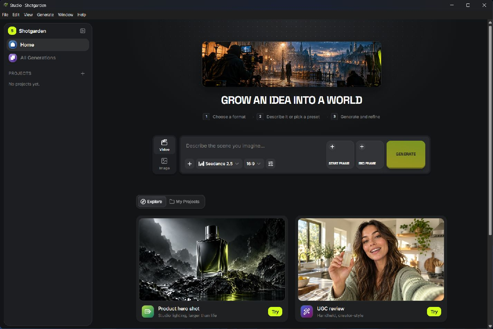

# Shotgarden Windows guide

Shotgarden is a local-first Windows studio for planning and generating cinematic images and video. It opens directly into the studio—no Shotgarden account or login is required.

## The golden path

1. Choose **Video** or **Image** in the prompt dock.
2. Describe the shot, or click a cinematic preset to seed a production-ready prompt.
3. Choose a model and aspect ratio. Add a start frame, end frame, or other references when the selected model supports them.
4. Open **All settings** for model-specific controls, then select **Generate**.
5. Review the result in **All Generations**. Create a project when you want to group shots into a sequence.
6. Use **File → Save Project As…** to save a portable `.shotgarden` project.

The three-step cue above the prompt dock keeps the primary workflow visible without adding another onboarding panel.

## Presets and projects

- **Explore** contains art-directed starting points. Selecting a card fills the prompt and switches format when needed.
- **My Projects** is for shot groups, campaigns, scenes, or sequences.
- Generated media becomes the visual cover for its project and can also drive the home hero, so the workspace gradually becomes your own.

## Providers and model keys

Open **Edit → API Providers…** to configure provider credentials on this computer. Shotgarden supports its installed Higgsfield/Kie-backed catalog and provider slots for OpenAI and Google Gemini workflows. Availability depends on the API key, account access, model region, and the provider's current API.

Credentials are stored locally by the desktop app and are not embedded in `.shotgarden` project files. Do not share API keys in screenshots or project notes.

## Project files

- **New Project**: `Ctrl+N`
- **Open Project…**: `Ctrl+O`
- **Save Project**: `Ctrl+S`
- **Save Project As…**: `Ctrl+Shift+S`

Windows associates `.shotgarden` files with the app, so a saved project can be opened from File Explorer. The project file has its own Shotgarden document icon.

## Studio shortcuts

- Switch to image: `Ctrl+1`
- Switch to video: `Ctrl+2`
- Focus the prompt: `Ctrl+L`
- Reload the studio: `Ctrl+R`
- Toggle full screen: `F11`

The standard **File, Edit, View, Generate, Window, and Help** menus expose the same actions for mouse-first workflows.

## Troubleshooting

- If **Generate** is disabled, enter a prompt or add the reference required by the selected model.
- If a request is rejected, confirm the provider key, model access, reference type, and attachment limit.
- If media does not refresh, use **View → Reload**. Each app launch uses a fresh local port and clears the renderer cache.
- If a project will not open, confirm it has the `.shotgarden` extension and was not edited as plain text.

## Where the app lives

The portable Windows build is at:

`C:\Users\eduni\Desktop\Shotgarden Windows App\Portable\Shotgarden.exe`

